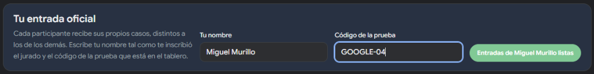
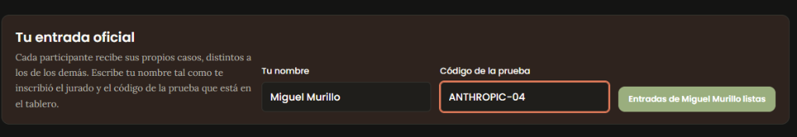
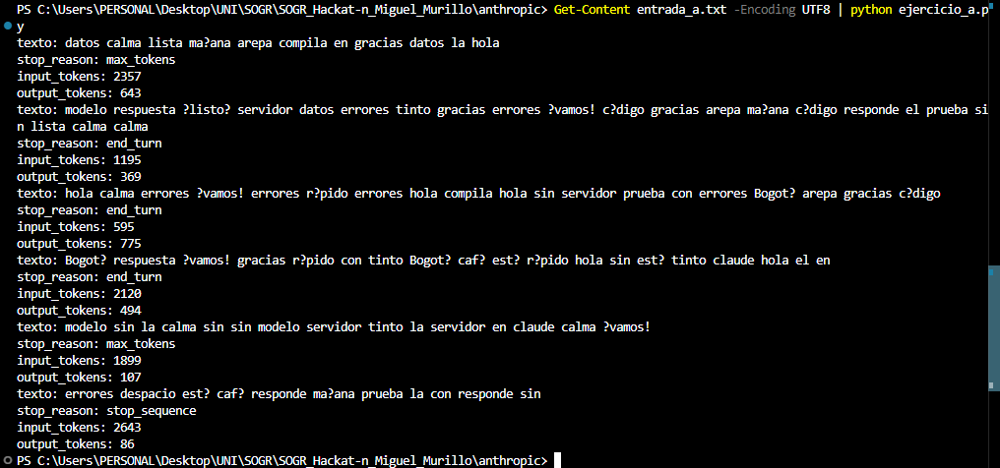
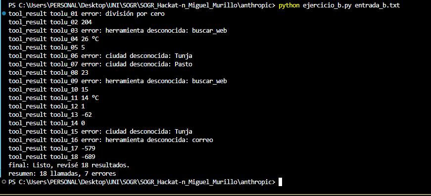
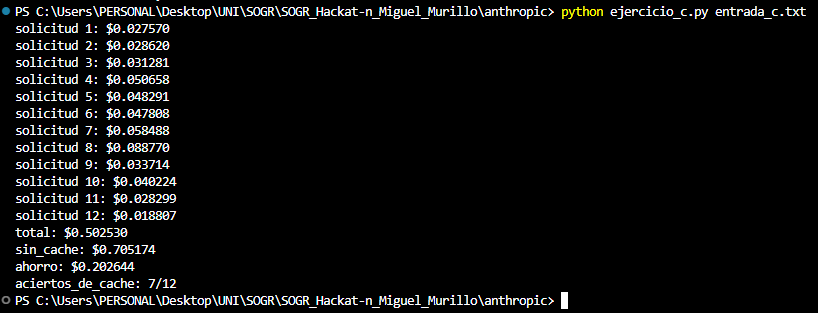
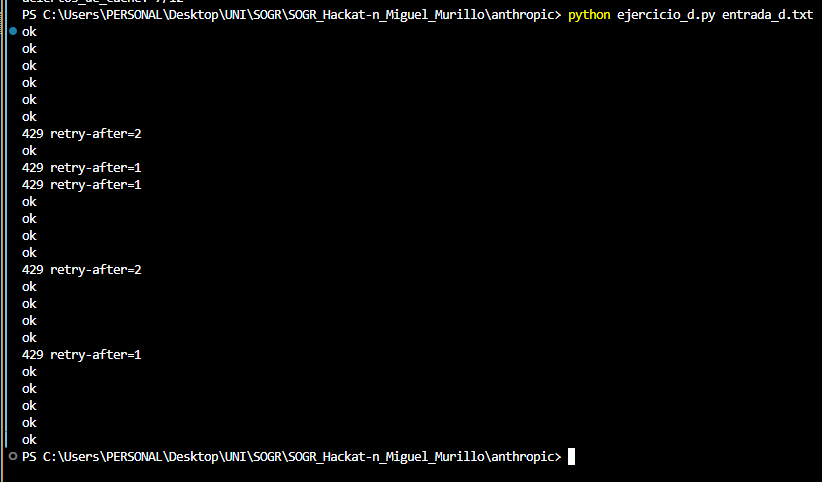
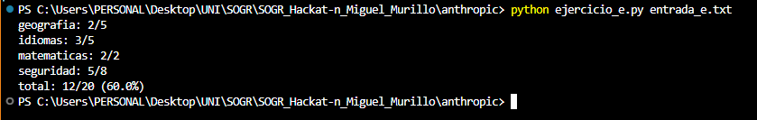

# SOGR Hackatón Individual 2026-2

**Estudiante:** Miguel Murillo  
**Curso:** SOGR 4 (2026-2)  
**Profesor:** Andrés Martín Cantor Urrego  

---

## 📌 Resumen de la Entrega

Este repositorio contiene las evidencias y soluciones correspondientes a la Hackatón Individual de SOGR 4, cubriendo las pruebas de **Google** y **Anthropic**.

| Prueba | Código Asignado | Estado |
| :--- | :--- | :--- |
| **Google** | `GOOGLE-04` | Pendiente |
| **Anthropic** | `ANTHROPIC-04` | ✅ Completada (5/5) |

---

## 📁 Estructura del Repositorio

```text
.
├── README.md              # Documentación y reporte de evidencias
├── google/                # Código fuente y scripts de la prueba Google
├── anthropic/             # Código fuente y scripts de la prueba Anthropic
└── evidencias/            # Capturas de pantalla (ingreso y salidas de ejecución)
```

---

## 🚀 1. Prueba Google (`GOOGLE-04`)

### 1.1 Evidencia de Ingreso (Nombre y Código)
> Captura de pantalla donde se evidencia el ingreso con nombre de usuario y el código `GOOGLE-04`.



### 1.2 Ejercicios y Salidas de Ejecución
*(Se completará a continuación)*

---

## 🚀 2. Prueba Anthropic (`ANTHROPIC-04`)

### 2.1 Evidencia de Ingreso (Nombre y Código)
> Captura de pantalla donde se evidencia el ingreso con nombre de usuario y el código `ANTHROPIC-04`.



### 2.2 Ejercicios y Salidas de Ejecución

* **Ejercicio A · Respuesta en streaming:**
  * **Descripción:** Reconstrucción de mensajes en streaming procesando eventos Server-Sent Events (`message_start`, `content_block_delta`, `message_delta`, `message_stop`), tokens de entrada/salida y motivos de finalización.
  * **Archivo fuente:** [`anthropic/ejercicio_a.py`](anthropic/ejercicio_a.py)
  * **Salida obtenida:**  
  

* **Ejercicio B · Uso de herramientas (Tool Use):**
  * **Descripción:** Ejecución ordenada de herramientas solicitadas por el modelo (`calculadora`, `clima`) controlando casos de error (división por cero, ciudades u operaciones no registradas) y reporte final de llamadas y fallos.
  * **Archivo fuente:** [`anthropic/ejercicio_b.py`](anthropic/ejercicio_b.py)
  * **Salida obtenida:**  
  

* **Ejercicio C · Costos con caché de prompts:**
  * **Descripción:** Cálculo exacto de costos en microdólares por solicitud según uso de tokens regulares, creación de caché (1.25x) y lectura de caché (0.10x), junto con el cálculo de ahorro total y tasa de aciertos de caché.
  * **Archivo fuente:** [`anthropic/ejercicio_c.py`](anthropic/ejercicio_c.py)
  * **Salida obtenida:**  
  

* **Ejercicio D · Límites de velocidad (Rate limits):**
  * **Descripción:** Algoritmo de Token Bucket para control de límites de velocidad (solicitudes por segundo y tokens de entrada), respondiendo `ok` o calculando el tiempo de espera entero hacia arriba (`429 retry-after=N`).
  * **Archivo fuente:** [`anthropic/ejercicio_d.py`](anthropic/ejercicio_d.py)
  * **Salida obtenida:**  
  

* **Ejercicio E · Evaluación de respuestas:**
  * **Descripción:** Normalización de cadenas y verificación de coincidencia por palabras completas agrupando por categorías alfabéticas y calculando porcentaje total de aprobación.
  * **Archivo fuente:** [`anthropic/ejercicio_e.py`](anthropic/ejercicio_e.py)
  * **Salida obtenida:**  
  

---

## 📅 Fecha Límite de Entrega
* **Fecha:** Sábado 14 de Noviembre de 2026
* **Hora:** 8:30 AM
